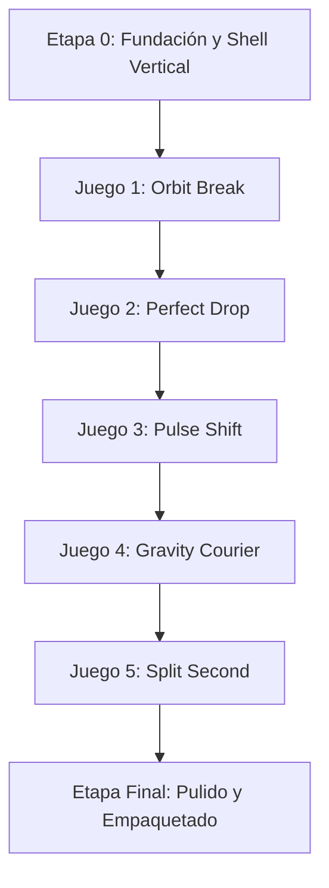

# PLAN DE DESARROLLO POR ETAPAS: PACK 5 MICROJUEGOS ARCADE

> [!IMPORTANT]
> **Modelo Comercial y Técnico: Premium 100% Offline (Buy-to-Play)**  
> - **Descarga única completa:** Todos los recursos (código, gráficos vectoriales, efectos de sonido y lógica) se encuentran empaquetados dentro del instalador original (APK/AAB para Android, ejecutable binario para PC).  
> - **Cero dependencia de Internet:** Prohibido el uso de servidores remotos, descargas secundarias post-instalación (sin parches externos, sin streaming de audio, sin CDNs). El usuario compra o descarga el juego y puede jugar de inmediato sin conexión.  
> - **Sin fricción:** Sin creación de cuentas, sin autenticación en la nube, sin anuncios y sin microtransacciones.  
> - **Persistencia puramente local:** Todos los récords, configuraciones y estados de partida se guardan exclusivamente en el almacenamiento local del dispositivo.

> **Formato de visualización:** Exclusivamente **vertical** (Portrait / Tate mode: resolución lógica recomendada `450 x 800` o relación 9:16) tanto para dispositivos móviles como para PC.  
> **Estilo visual:** **Retro vectorial** minimalista (estética de líneas neón inspirada en arcade clásico/Vectrex, alto contraste sobre fondos oscuros).  
> **Efectos visuales ("Game Juice"):** Partículas geométricas luminosas para impactos, estelas de movimiento y explosiones vectoriales al colisionar o perder.  
> **Paleta retro:** Colores brillantes clásicos (Verde fósforo `#39FF14`, Cyan neón `#00F5D4`, Magenta arcade `#FF007F`, Ámbar eléctrico `#FFB703`, Blanco destello `#FFFFFF`) sobre fondo negro profundo (`#0A0A0F`).

---

## ESTRUCTURA DEL SISTEMA PRINCIPAL (SHELL Y MENÚS)

El proyecto cuenta con un concentrador común antes y después de cada juego:
* **Menú Principal de Selección:** Carrusel o selector vertical de los 5 microjuegos con acceso directo, visualización del récord (High Score) actual de cada uno y estado de desarrollo (Jugable / Próximamente).
* **Pantalla de Configuración:** Ajustes de audio (volumen y silencio para música y efectos SFX) y opción de accesibilidad para regular la intensidad de partículas/sacudida de pantalla.
* **Overlays Comunes:**
  * `ReadyOverlay`: Instrucción concisa de una línea (ej. *"Toca o pulsa ESPACIO para iniciar"*).
  * `InGameHUD`: Telemetría perimetral no intrusiva (puntos, multiplicador, barra de estado).
  * `PauseOverlay`: Congela la simulación, permite regular sonido o salir al menú.
  * `GameOverOverlay`: Muestra el puntaje final, notificación festiva si se batió el récord y botón de **reinicio inmediato con un solo toque**.

---

## ETAPAS DE DESARROLLO POR JUEGO Y SISTEMA

---

### ETAPA 0: FUNDACIÓN DEL PROYECTO Y BASE VERTICAL

- [x] **Etapa 0.1:** Creación del proyecto Flutter e integración de dependencias iniciales (`flame`, `shared_preferences`).
- [x] **Etapa 0.2:** Bloqueo de orientación vertical obligatoria (`DeviceOrientation.portraitUp` en móvil y ventana fija vertical `450x800` en PC).
- [x] **Etapa 0.3:** Sistema de persistencia local para récords individuales y configuración de sonido.
- [x] **Etapa 0.4:** Motor compartido de efectos visuales (emisor ligero de partículas geométricas vectoriales y destellos de impacto).
- [x] **Etapa 0.5:** Menú principal con selección de juego, visualización de puntuaciones y pantalla de configuración de sonido/efectos.
- [x] **Etapa 0.6:** Integración de la máquina de estados de sesión (`ready`, `playing`, `paused`, `finished`) conectada con los overlays de Flutter.

---

### JUEGO 1: ORBIT BREAK
*Mecánica: Esfera orbitando un núcleo central; un toque invierte el giro para esquivar y recolectar.*

- [x] **Etapa 1.1 (Mecánica Core):** Núcleo central vectorial, esfera orbital y control de inversión de dirección mediante toque en pantalla o barra espaciadora.
- [x] **Etapa 1.2 (Peligros y Colisión):** Generación de obstáculos angulares y radiales con hitboxes de precisión.
- [x] **Etapa 1.3 (Partículas y Recolección):** Generación de partículas de energía que aportan puntos y dejan estela de luz al recogerse.
- [x] **Etapa 1.4 (Efectos de Destrucción):** Explosión vectorial de fragmentos luminosos al colisionar contra un obstáculo y fin de partida.
- [x] **Etapa 1.5 (Progresión y Récord):** Incremento gradual de velocidad de rotación y frecuencia de peligros, cálculo de puntuación y guardado del récord local.
- [x] **Etapa 1.6 (Validación y Pruebas):** Pruebas unitarias de puntuación, control de reinicio limpio y balance de dificultad.

---

### JUEGO 2: PERFECT DROP
*Mecánica: Apilamiento vertical de plataformas móviles con recorte de secciones desalineadas.*

- [x] **Etapa 2.1 (Mecánica Core):** Plataforma base y generación de plataforma móvil oscilante horizontal.
- [x] **Etapa 2.2 (Algoritmo de Recorte):** Detección de alineación, recorte exacto del sobrante desalineado y animación de caída del fragmento residual.
- [x] **Etapa 2.3 (Cadena de Precisión):** Recompensa de "Perfect Drop" al alinear con precisión milimétrica (destello visual, expansión de partículas y multiplicador acumulativo).
- [x] **Etapa 2.4 (Tipos de Bloques):** Introducción progresiva de bloques especiales (bloque estándar, elástico, pesado o frágil).
- [x] **Etapa 2.5 (Colapso y Fin de Partida):** Condición de derrota al errar por completo la plataforma, explosión en cadena de la torre y registro de altura máxima.
- [x] **Etapa 2.6 (Validación y Pruebas):** Pruebas unitarias de corte, precisión y persistencia del récord.

---

### JUEGO 3: PULSE SHIFT
*Mecánica: Runner vertical de desplazamiento rápido con dos carriles y reactividad al cambio.*

- [x] **Etapa 3.1 (Mecánica Core):** Desplazamiento vertical automático de la entidad sobre dos superficies/carriles paralelos.
- [x] **Etapa 3.2 (Cambio de Superficie):** Acción de cambio instantáneo de carril con estela de partículas y cambio cromático reactivo.
- [x] **Etapa 3.3 (Obstáculos Dinámicos):** Obstáculos fijos y elementos que cambian de fase o se abren/cierran cuando el jugador realiza un cambio.
- [x] **Etapa 3.4 (Puntos y Coleccionables):** Orbes de energía ubicados en trayectorias de riesgo para premiar reflejos rápidos.
- [x] **Etapa 3.5 (Colisión y Explosión):** Efecto de choque de alto impacto con chispas vectoriales y sacudida de pantalla sutil.
- [x] **Etapa 3.6 (Validación y Pruebas):** Curva de aceleración, pruebas unitarias de colisión y registro de mejores marcas.

---

### JUEGO 4: GRAVITY COURIER
*Mecánica: Desplazamiento vertical continuo alternando gravedad entre dos paredes con opción de carga.*

- [x] **Etapa 4.1 (Mecánica Core):** Movimiento vertical continuo con cambio de gravedad lateral hacia la pared opuesta al pulsar.
- [x] **Etapa 4.2 (Sensación Física):** Curva de aceleración/desaceleración responsiva durante la transición entre paredes.
- [x] **Etapa 4.3 (Peligros y Trampas):** Picos, barreras electromagnéticas y compuertas móviles ancladas a las paredes.
- [x] **Etapa 4.4 (Mecánica de Carga):** Posibilidad de recoger un módulo de transporte con peso e inercia que altera ligeramente la maniobrabilidad.
- [x] **Etapa 4.5 (Explosión y Puntuación):** Destrucción por contacto con fragmentación vectorial y puntuación basada en distancia recorrida.
- [x] **Etapa 4.6 (Validación y Pruebas):** Verificación de no atravesar obstáculos por saltos de frame y balance del control.

---

### JUEGO 5: SPLIT SECOND
*Mecánica: Dos entidades en carriles paralelos controladas simultáneamente con una sola acción.*

- [x] **Etapa 5.1 (Mecánica Core):** División de la pantalla vertical en dos vías independientes con dos figuras sincronizadas.
- [x] **Etapa 5.2 (Control Compartido):** Un solo comando (toque o espacio) acciona la maniobra evasiva en ambas entidades a la vez.
- [x] **Etapa 5.3 (Diseño de Patrones):** Generación de secuencias de obstáculos calibradas para requerir atención dividida sin crear situaciones imposibles.
- [x] **Etapa 5.4 (Sinergia Cruzada):** Bonificadores recolectados por una figura que activan un pulso de defensa o abren paso en la otra pista.
- [x] **Etapa 5.5 (Explosión Dual y Derrota):** La caída de cualquiera de las entidades detona una explosión vectorial y detiene la partida.
- [x] **Etapa 5.6 (Validación y Pruebas):** Pruebas intensivas de justicia visual, legibilidad y tolerancia al estrés del jugador.

---

### ETAPA FINAL: INTEGRACIÓN, PULIDO Y EMPAQUETADO

- [x] **Etapa F.1 (Efectos de Sonido Retro):** Integración de audio retro sintetizado (tonos limpios chiptune/arcade para saltos, aciertos, recolección y explosiones).
- [x] **Etapa F.2 (Efectos Visuales Globales):** Pulido del renderizado vectorial, resplandores neón (*bloom* sutil programático) y consistencia de partículas.
- [x] **Etapa F.3 (Revisión de Flujo y Ergonomía):** Verificación de tiempos de respuesta, reinicios instantáneos y navegación fluida entre juegos y menús.
- [x] **Etapa F.4 (Builds y Compatibilidad):** Verificación en emulador/dispositivo Android y ejecución en PC/Windows en ventana vertical.
- [x] **Etapa F.5 (Verificación Offline Estricta):** Prueba integral en modo avión / sin red para certificar que el 100% de la funcionalidad (todos los juegos, menús, audio, récords y ajustes) opera sin requerir conexión a internet.
